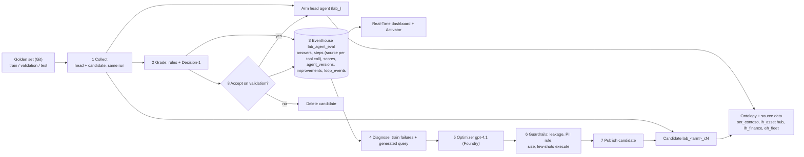

# Data agent feedback loop: live2.5-20261112T032700Z

Sample, not production guidance. Synthetic data. Generated by `py eval/feedback_loop.py report`. Capacity: F128. The live timeline, sources and tokens are in the `lab_rtd_agent_eval` Real-Time dashboard (Eventhouse `lab_agent_eval`).

## Architecture

Splits: proposals come only from **train** failures, candidates are accepted on **validation** (train gain ≥ 2 questions, validation not worse, no forbidden-data failure, no category drop > 1), and **test** is scored once, at the end. Heads and candidates are asked in the same run (paired).

## Result

| Arm | v0 | Final head | Test v0 → head | All questions v0 → head | Rounds accepted |
|---|---|---|---|---|---|
| A | `lab_da_360_onto` | `lab_da_360_onto` | 100% → 100% | 96% → 96% | 0 |
| B | `lab_da_onto_hub_bare` | `lab_da_onto_hub_bare` | 75% → 75% | 77% → 77% | 0 |

## Arm A: rounds

| Round | Head | Candidate | Train head → cand | Validation head → cand | Decision | Reason | Optimizer tokens |
|---|---|---|---|---|---|---|---|
| 0 (baseline) | `lab_da_360_onto` | - | 21/22 | 12/14 | - | - | - |
| 1 | `lab_da_360_onto` | `lab_da_360_onto_c1` | 20/22 → 20/22 | 10/14 → 12/14 | rejected | train gain +0 < 2 | 1,920/466 |
| 2 | `lab_da_360_onto` | `lab_da_360_onto_c2` | 19/22 → 20/22 | 12/14 → 12/14 | rejected | train gain +1 < 2 | 2,027/630 |

## Arm B: rounds

| Round | Head | Candidate | Train head → cand | Validation head → cand | Decision | Reason | Optimizer tokens |
|---|---|---|---|---|---|---|---|
| 0 (baseline) | `lab_da_onto_hub_bare` | - | 16/22 | 12/14 | - | - | - |
| 1 | `lab_da_onto_hub_bare` | `lab_da_onto_hub_bare_c1` | 15/22 → 17/22 | 12/14 → 11/14 | rejected | validation 11 < 12 | 3,655/1,409 |
| 2 | `lab_da_onto_hub_bare` | `lab_da_onto_hub_bare_c2` | 14/22 → 14/22 | 12/14 → 9/14 | rejected | train gain +0 < 2; validation 9 < 12; category drop > 1 question: multi_hop | 4,489/1,852 |

## Sources and tokens (final run)

Share of executed queries per data source (from the agent's run steps) and token usage per answer.

| Agent | Queries by source | Answers without a query | Prompt tokens / answer | Completion tokens / answer | p50 latency |
|---|---|---|---|---|---|
| `lab_da_360_onto` | lh_asset 50%, lh_finance 27%, eh_fleet 23% | 6/48 | 40,145 | 155 | 16.6 s |
| `lab_da_onto_hub_bare` | lh_asset 100% | 8/48 | 26,391 | 139 | 11.1 s |
