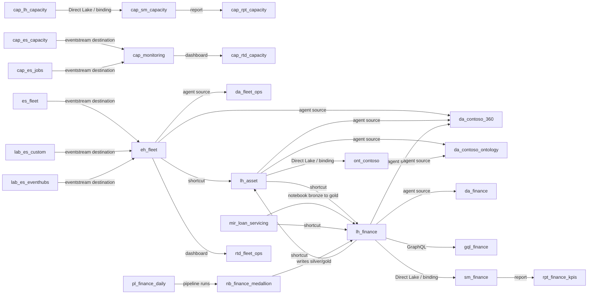

# Lineage (generated)

Generated by `py infra/governance.py lineage` from the item definitions in `/workspaces`
(names only). Compare with the portal's lineage view and the Scanner API (`governance.py scan`).

## Impact analysis examples

- **lh_asset** → da_contoso_360, da_contoso_ontology, da_finance, gql_finance, lh_finance, ont_contoso, rpt_finance_kpis, sm_finance
- **eh_fleet** → da_contoso_360, da_contoso_ontology, da_finance, da_fleet_ops, gql_finance, lh_asset, lh_finance, ont_contoso, rpt_finance_kpis, rtd_fleet_ops, sm_finance
- **mir_loan_servicing** → da_contoso_360, da_contoso_ontology, da_finance, gql_finance, lh_asset, lh_finance, ont_contoso, rpt_finance_kpis, sm_finance
